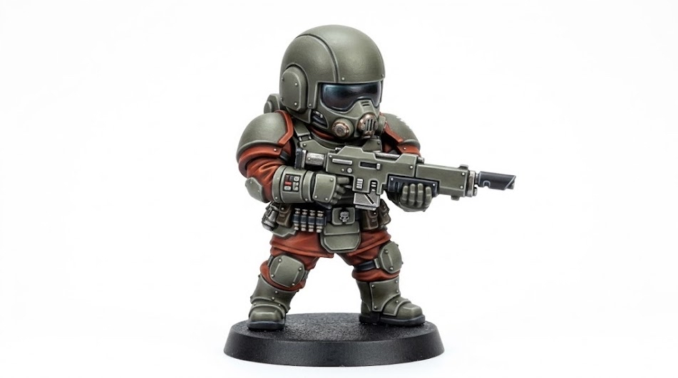
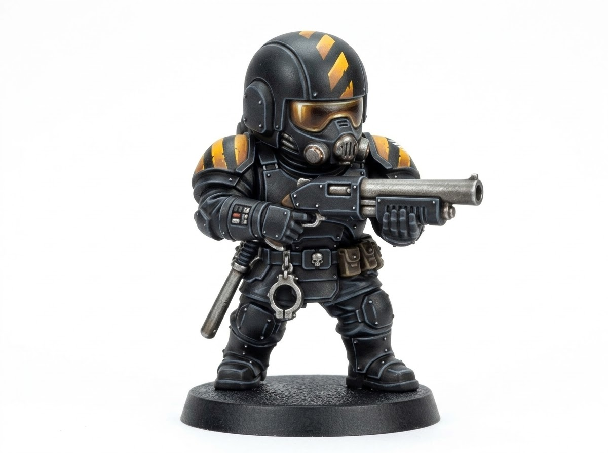
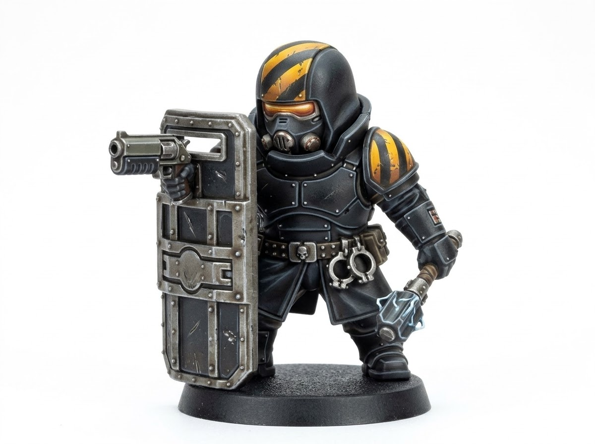
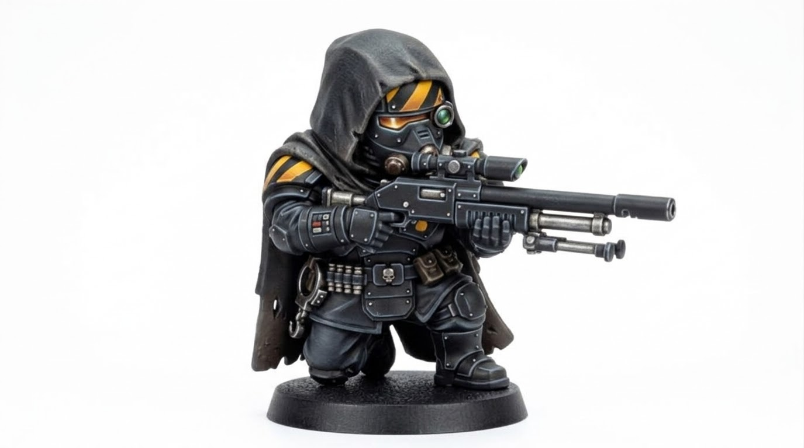
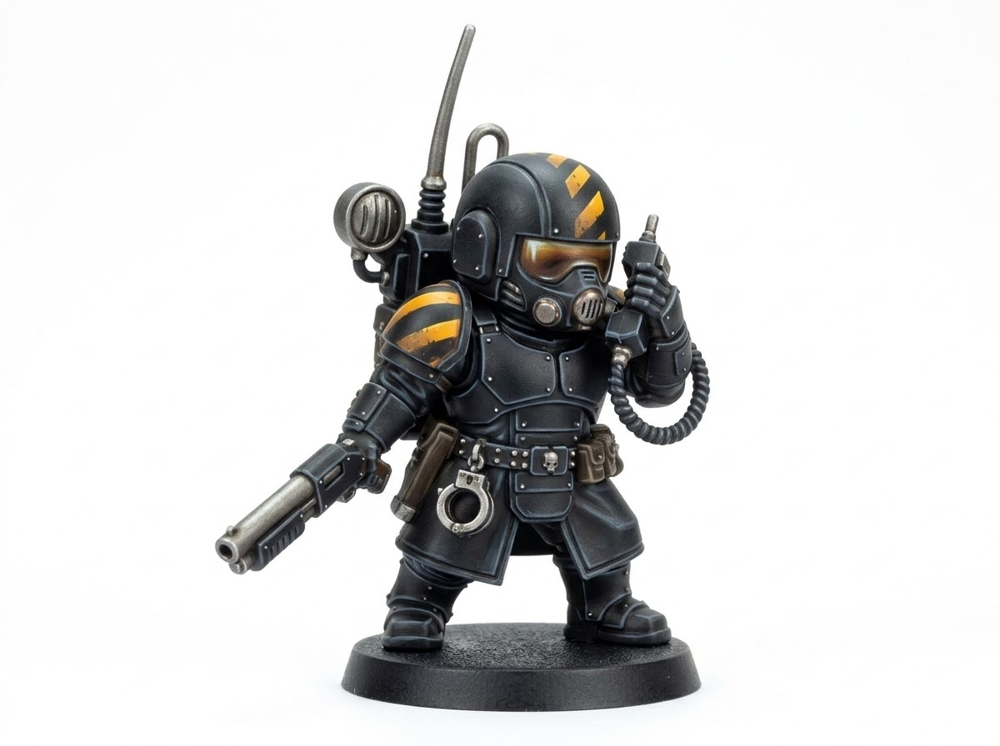
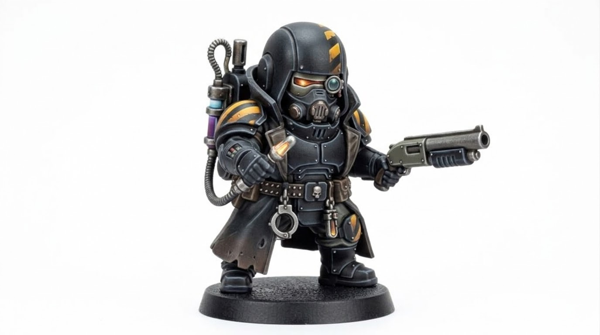
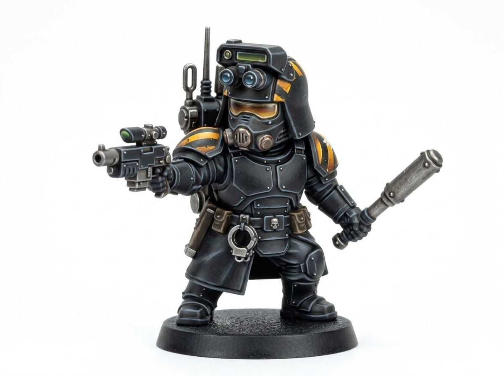
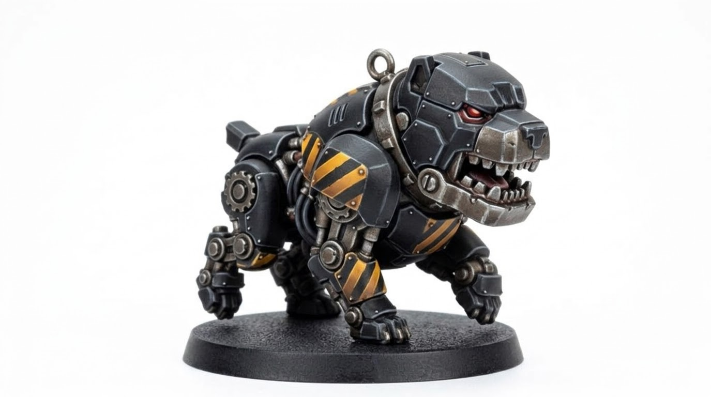

# Project X — Game Design (draft 5)

Turn-based squad tactics with a doomsday-clock campaign, set in a corporate megacity. Working title and all proper names are placeholders.

**Status:** mechanics draft. Every number marked *(tune)* is a starting guess that the clock simulation (see Build Plan) should check.

**Changelog**
- Draft 5: the dark pole of the alignment scale is named **Ruthless** (owner, 2026-11-08); no eagles or other 40k marks in the art.
- Draft 4: the Arbiter as judge, jury and executioner: **Verdicts** on surrendered suspects, a **Just ↔ Ruthless alignment** scale, split Just/Ruthless capstones, and the city's **other Arbiters** (allies, rivals, a corrupt insider, judgement calls).
- Draft 3: added the **Arbiter** (player's leader unit, Command Points and orders, four specialization trees, recovery penalties); settled the hit model, noise activation, ammo, elevation and trooper morale for the prototype.
- Draft 2: added megacorps (Standing, gear lines, corp security, rivalries, a secret syndicate backer, shady requests), the mech, and vehicles (APC, air support, strategic fleet).
- Draft 1: core concept, arrests, Alarm, units, Takeover clock, case board.

---

## 1. Pitch

You command a precinct of armored enforcers in a decaying megacity run in all but name by four megacorporations. A crime syndicate is quietly buying, bribing and shooting its way toward **the Takeover**: full control of the city. You cannot answer every call. Each week you choose which district to defend and which corporate patron to keep happy, and whatever you ignore slips further away.

You win by working up the syndicate's chain of command: arresting street crews, breaking them in interrogation, finding the Lieutenants, and taking down the Kingpin before the Takeover completes. Somewhere along the way you will learn that one of your corporate patrons has been funding the syndicate all along, and that one of your fellow Arbiters has been helping them.

You are the **Arbiter**: judge, jury and executioner. How you deliver justice is up to you. Arrest, release, or execute on the spot; question prisoners fairly or break them. The city, the corps and the other Arbiters will judge you for it, and the most powerful abilities only open up to Arbiters who commit to being truly just or truly ruthless.

### Locked decisions

| Topic | Decision |
|---|---|
| Threat | Crime syndicate working toward a city takeover |
| Arrests | **Core pillar.** Intel from prisoners is the main way to push the clock back |
| Mission pressure | Soft escalation (Alarm), no instant-fail turn timers |
| The player | The **Arbiter**: a unique leader unit. Optional deployment in a regular slot; can't die but needs a long recovery when downed, with strategy-layer penalties; four specialization trees |
| Alignment | One visible **Just ↔ Ruthless** axis, moved by verdicts, interrogation methods, collateral damage and shady corp requests |
| Ultimates | Each tree's capstone has a Just and a Ruthless version; a middle-of-the-road Arbiter can't take capstones |
| Other Arbiters | NPC Arbiters as allies, rivals, one corrupt insider, and subjects of judgement calls |
| Starting troops | Olive/red **Recruits**, who promote into the specialty classes |
| Squad size | 4 at the start, growing to 6 through precinct upgrades |
| Campaign length | Short: 8–12 hours, about 20–25 missions |
| Permadeath | Yes, with a mercy option (downed troopers can be stabilized and evacuated) |
| Megacorps | 4 corps, each with a **Standing** meter that unlocks its gear line |
| Corp troops | Third-party security on their turf (friend or foe by Standing), plus callable reinforcement squads at high Standing |
| Corp politics | Rivalries, one **secret syndicate backer** (random per campaign), and shady requests |
| Mech | Takes a squad slot; piloted by a promoted trooper who earns XP |
| Vehicles | APC on the map, off-map air support, and a strategic fleet that sets response range |
| Hit model | Percent + graze: near-misses deal half damage but full Resolve damage |
| Enemy activation | Noise-based: unaware groups wake to loud actions within earshot; quiet takedowns don't alert them |
| Ammo | None (v1 prototype); grenades, gas and support calls carry the resource pressure |
| Elevation | Flat maps in the v1 prototype |
| Trooper morale | Only enemies have Resolve; troopers never panic (suppression gives them an aim penalty) |
| Engine | Undecided; the tactical layer is prototyped on the web first (see [PROTOTYPE-PLAN.md](PROTOTYPE-PLAN.md)) |

---

## 2. Pillars

1. **Arrest beats kill.** Killing is faster and safer. Arresting is what wins the campaign. That trade-off comes up in every mission.
2. **The squad carries its own advantages.** Shields are portable cover, respirators let the squad fight inside its own gas, night vision turns darkness into an asset, and the mech and APC are cover that moves.
3. **The case is the campaign.** The syndicate org chart is the progression map. Every arrest is a lead.
4. **Every patron has a price.** Corporate gear makes your squad stronger, but corps want favours, hate each other, and one of them is lying to you.
5. **Your justice, your way.** Mercy and cruelty both work, and both cost something. The game never tells you which is right; it shows you who you've become.

---

## 3. Units

### 3.0 The Arbiter (the player)
*Concept art needed.* The precinct's commander and the player's own character: someone who should read as the law on the battlefield, distinct from every trooper at a glance.

**Deployment**
- **Optional:** the Arbiter takes a regular squad slot when deployed. Leaving them at the precinct is safe but costs the squad their orders, so it's a weekly risk/reward call.
- A little stronger than a trooper: HP 10, Mobility 6, Aim 70 *(tune)*. Heavy pistol and shock baton (placeholder kit).

**Command Points and orders**
- The Arbiter has a **Command Point (CP)** pool: starts at 1, +1 per round, max 3, and +1 for each arrest the squad makes *(tune)*.
- **Command range:** orders reach any trooper within 6 tiles of the Arbiter, **or anywhere if the Vox Operator is deployed** (the radio carries the order). This replaces the Vox's own Relay Orders once the Arbiter is in.

| Starting order | CP | Effect |
|---|---|---|
| **Advance** | 1 | A trooper gains +1 move action this turn |
| **Focus Fire** | 1 | The squad gets +10 aim against one target until the end of the turn |
| **Drop Your Weapons!** | 2 | Every enemy within 4 tiles with line of sight takes 2 Resolve damage. Doesn't raise Alarm, but alerts unaware groups in that radius |

**Verdicts**
Only the Arbiter delivers verdicts. Troopers can cuff a surrendered suspect (a plain arrest) but can't harm one, so every act of mercy or cruelty is the player's own choice.

A verdict costs 1 action, targeting a surrendered suspect within 4 tiles with line of sight *(tune)*.

| Verdict | Effect | Alignment *(tune)* |
|---|---|---|
| **Arrest** | Cuffed as normal; full intel | +1 |
| **Release** | The suspect walks free as an informant: no intel now, but a tip arrives 2–3 weeks later (a case-board reveal or an ambush warning) | +5 |
| **Make an Example** | Beaten and cuffed in front of their friends: enemies within 6 tiles who see it take 2 Resolve damage; the prisoner yields half intel | −4 |
| **Execute** | Killed on the spot: enemies within 6 tiles who see it take 3 Resolve damage; no intel; loud | −8 |

**Down, not dead**
- The Arbiter **can't die**. When downed, the bleed-out timer still runs; if it expires, the Arbiter is evacuated instead of killed. Either way the mission continues without them.
- A downed Arbiter goes into **recovery** for 3 weeks *(tune)*, shortened by the Infirmary. Recovery penalties are in 5.8.

**Specialization trees**
- The Arbiter earns perk points from missions they deploy on and from campaign milestones (Lieutenant arrests, retaking a district). About 8 points over a campaign *(tune)*, against 16 perks, so the player can't fill every tree.
- Perks can be mixed across trees. Each tree has 3 regular perks and a **capstone** that needs the other three. Each capstone comes in a **Just** and a **Ruthless** version (see 7.3).

| Tree | Focus | Regular perks (draft) |
|---|---|---|
| **Tactician** | Command | +1 max CP; *Coordinated Watch* (when the Arbiter overwatches, allies in range overwatch for free); *Seize the Initiative* (start missions with full CP) |
| **Magistrate** | The law | *Drop Your Weapons!* radius 6 and costs 1 CP; *Read Them Their Rights* (cuffing next to the Arbiter is free); *Judgement* (surrendered enemies near the Arbiter can't be rallied) |
| **Vanguard** | Leading from the front | +3 HP and armor; *Lead from the Front* (allies within 2 tiles get +10 aim); *Bodyguard* (takes a shot aimed at an adjacent ally) |
| **Envoy** | Politics (strategy layer only) | +50% corp Standing gains; rival Standing loss halved; Order decays more slowly in districts the Arbiter visited |

Envoy perks do nothing on the battlefield. That's the trade-off: a political Arbiter is a weaker field commander.

### 3.1 Recruit (starting trooper)


- Olive armor with red fatigues, standard rifle, cuffs.
- Solid generalist: one rifle, one grenade, can cuff.
- At **Rank 2** *(tune)* the player promotes them into a specialty. Promotion is also a visual change: the recruit trades olive for precinct black with hazard stripes.

### 3.2 Specialties

| Specialty | Concept | Role | Signature abilities (draft) |
|---|---|---|---|
| **Enforcer** |  | Breach and clear | Shotgun bonus up close; *Breach* (opens a door and fires as one action); cuffs as a free action |
| **Bulwark** |  | Mobile cover | Riot shield gives **half cover** to self and adjacent allies, facing-based; *Shield Bash* (Resolve damage plus stun); shock maul |
| **Marksman** |  | Long range, control | Long-range overwatch; *Pinning Shot* (non-lethal leg shot, target can't move next turn, Resolve damage) |
| **Vox Operator** |  | Support, comms | *Call Support* (drone scan, air support, corp squad; uses a mission-wide charge pool); *Relay* (extends the Arbiter's orders to the whole map; without the Arbiter, *Relay Orders* grants an ally an extra action instead) |
| **Chem Trooper** |  | Area denial, medic | Gas grenades (see 4.4); *Stim* (heal, or +1 move); stabilizes downed allies at range 2 |
| **Recon** |  | Scout, leader | Night vision (sees into dark tiles); *Mark Target* (+aim and +Resolve damage against target for the squad); pistol and baton |

Each specialty gets a small promotion tree (2 choices per rank, about 4 ranks), kept small to fit the short campaign. Corp gear (section 6) adds variety on top without growing the trees.

### 3.3 K9 unit


- A **robotic unit, not a trooper.** Built in the Robotics Bay, not promoted.
- Fills a squad slot. Repaired between missions rather than injured, and it can still be destroyed.
- Fast (double move). *Tackle* pins a target and deals heavy Resolve damage. *Track* reveals hidden enemies and evidence caches within a radius.

### 3.4 Mech (piloted walker)
*Concept art needed.* Precinct black with hazard stripes, heavier and taller than any trooper.

- **Takes 1 squad slot.** It is piloted by a trooper of **Rank 3+** *(tune)* of any specialty, who must first pass pilot training in the Robotics Bay.
- **The pilot earns XP** while piloting and keeps their own specialty for missions on foot.
- **Built from the precinct's own chassis** (unlocked in the Robotics Bay). Corps supply the **loadouts**, so losing access to one corp never removes the mech entirely.

**On the tactical map:**
- Large (2×2 footprint *(tune)*), heavily armored, slow to turn.
- Cannot use cover, but **is full cover** for allies directly behind it.
- Walks through low cover and thin walls, destroying them.
- **Loud:** each turn the mech acts adds +1 Alarm. That is its built-in cost against the arrest pillar.
- **If destroyed,** the pilot ejects at low Health on an adjacent tile and is exposed. The normal downed/mercy rules apply from there.
- Repaired between missions (downtime scales with damage).

**Loadouts** (one per mission, swapped in the precinct):

| Loadout | Source | Weapons and tools | Plays as |
|---|---|---|---|
| **Assault** | Arms corp | Autocannon, rocket pod | Lethal, very loud; clears heavies |
| **Riot Control** | Biotech corp | Sonic cannon (cone of Resolve damage), gas mortar | Arrest engine; quieter |
| **Breacher** | Robotics corp | Hydraulic ram (opens walls), net launcher (immobilize) | Opens new routes; pins targets for cuffing |

### 3.5 Corp security (allied or third party)
Each corp fields its own security troopers in its own livery (see section 6). They are **AI-controlled**, never player-controlled. They kill rather than arrest, which means a friendly corp squad can cost you a prisoner.

---

## 4. Tactical Layer

### 4.1 Core (familiar on purpose)
- Grid-based, **2 actions per unit per turn** (move + act, or double move). Firing usually ends the turn.
- Half and full cover, flanking (no cover bonus), overwatch, hunker down.
- Destructible cover and walls.

### 4.2 Resolve and arrests (core pillar)
Every enemy has **Health** and **Resolve**.

- **Resolve damage** comes from suppression fire, gas, shield bash, K9 tackle, pinning shots, the mech's sonic cannon, flanks, and seeing allies arrested or killed nearby.
- **Wounded bonus:** below 50% Health, Resolve damage taken is doubled *(tune)*. You can shoot someone toward surrender.
- **Resolve 0 means Surrender.** The enemy drops their weapon and kneels.
- **Cuffing** costs 1 action from an adjacent trooper (free for Enforcers). Uncuffed surrendered enemies can be **rallied** by a nearby syndicate leader at the start of the enemy turn and return to the fight.
- **Securing prisoners:** all cuffed suspects are secured when the mission succeeds. If the squad evacuates early, only prisoners **loaded in the APC** or adjacent to an evac tile come along. The rest are lost.
- **Leaders and the Kingpin** have high Resolve and resist effects; arresting them is a deliberate goal, not an accident.
- **Kill vs. arrest:** kills give no intel and raise Alarm. Arrests give intel and are quieter.

### 4.3 Alarm (soft escalation)
Each mission has an **Alarm** meter, 0–10 *(tune)*.

- +1 at the end of every round.
- +1 the first time each round that a loud weapon fires (rifles, shotguns, revolvers).
- +1 each turn the mech acts.
- +2 for explosions; +3 for an air-support strafing run.
- Baton, maul, gas, tackle and suppressed shots are quiet.

| Alarm | Effect *(tune)* |
|---|---|
| 4 | First syndicate reinforcement wave |
| 7 | Evidence starts being destroyed; VIP targets try to flee the map |
| 10 | Heavy response: elite squad arrives, and remaining evidence is lost |

This rewards quiet, controlled play without failing the mission outright.

### 4.4 Gas, light and civilians
- **Gas clouds** last 3 turns *(tune)*. Enemies inside take Resolve damage and an aim penalty each turn. Troopers are immune because of their respirators (later enemy types and some corp security may have masks).
- **Darkness:** unlit tiles hide units beyond 2 tiles. Recon (night vision) and K9 (tracking) ignore this. Shooting out lights is an option.
- **Civilians** appear on many maps. Civilian casualties cost **Order** in that district (see 5.2), and Standing with that district's corp patron.

### 4.5 Downed troopers (mercy option)
- At 0 Health a trooper is **Downed** and bleeds out after **2 turns** *(tune)*.
- An adjacent ally (or a Chem Trooper within range 2) can **Stabilize** them for 1 action. A stabilized trooper survives with a long injury.
- If they bleed out or the squad leaves them behind, they are dead for good.

### 4.6 Corp security on the map
On missions inside a corp's territory, that corp's security may already be on the map as a **third-party AI faction**. How they act depends on your Standing with that corp:

| Standing tier | Corp security behaviour |
|---|---|
| Hostile | Attacks troopers and syndicate alike |
| Cold | Doesn't shoot you, but blocks doors, locks down evidence, and won't let you through their checkpoints |
| Neutral | Defends its own assets; ignores you |
| Friendly or better | Fights the syndicate alongside you |

**Called-in corp squads:** at **Trusted** Standing or above, the Vox Operator can spend a support charge to bring in a 2–3 trooper corp squad *(tune)*. They arrive at the map edge, stay for 3 turns *(tune)*, and act on their own. They are strong, but they shoot to kill and take no prisoners.

### 4.7 APC (on-map vehicle)
Used on street and open maps (not every map fits it).

- **Player-controlled.** One move action per turn; it doesn't take a squad slot.
- **Full cover** for adjacent allies on the side away from fire.
- **Mobile evac point:** troopers can extract from any tile next to it.
- **Prisoner hold:** a trooper can load an adjacent cuffed suspect (1 action). Up to 4 prisoners *(tune)*. Loaded prisoners are safe even if the mission goes badly.
- **Mounted gun** (optional upgrade): loud, lethal.
- Can be **disabled** by syndicate heavies. A disabled APC is still cover but can't move or evac.

### 4.8 Off-map air support
Called by the Vox Operator, using the shared support-charge pool.

| Call | Effect | Alarm |
|---|---|---|
| **Strafing run** | Lethal line attack | +3 |
| **Smoke drop** | Blocks line of sight in an area for 2 turns | +1 |
| **Spotlight** | Lights an area (removes darkness) for 2 turns | +1 |
| **Hot extraction** | Opens an evac point anywhere visible | +2 |

Better calls and more charges come from the Logistics corp and the Comms Room.

### 4.9 Mission types (first pass)
| Type | Goal | Notes |
|---|---|---|
| **Bust** | Arrest a named target | Bread-and-butter intel mission |
| **Raid** | Hit a syndicate operation site, seize evidence | Only from leads; pushes the clock back |
| **Response** | Stop an active crime (robbery, gang fight) | Civilian-heavy; Order at stake |
| **Escort / Protect** | Keep a witness or official alive | Syndicate assassins |
| **Contract** | Corp request: recover a prototype, guard a shipment | Standing reward; competes with district incidents |
| **Takedown** | Arrest a Lieutenant | Story missions; unique map per Lieutenant |
| **Exposure** | Hit the secret backer corp (after the reveal) | Pushes the Takeover back; corp security is hostile |
| **Kingpin** | Final mission | Unlocked by the case board |

---

## 5. Strategy Layer

### 5.1 Weekly loop
1. **Incidents appear:** 2–3 per week *(tune)* across the city map, plus the occasional corp Contract or shady request.
2. **Choose one to deploy to.** A second squad (later upgrade) can take a second incident.
3. **Ignored incidents** cost that district 1 Order. Ignored corp Contracts cost a little Standing with that corp.
4. **After the mission:** interrogate prisoners, spend Funding and Evidence, buy corp gear, heal and repair, promote.
5. **The Takeover advances** (see 5.3).

### 5.2 Districts and Order
- **6 districts** *(tune)* for the short campaign, each with **Order 0–5** and a **corp patron** (the corp that owns most of it).
- Order sets that district's **Funding** each month, and moves Standing with its patron (keeping a corp's districts orderly pleases it).
- **At 0 Order the district falls** to the syndicate: no funding, +2 Takeover *(tune)*, −1 Standing with its patron, and syndicate units there get a bonus. A fallen district can be retaken with a dedicated mission.

### 5.3 The Takeover (doomsday clock)
- A track of **12 segments** *(tune)*.
- Advances **+1 every 2 weeks** on schedule, **+2 when a district falls**, **+1 when a Lieutenant's operation completes a milestone**, and secretly through favours done for the backer corp (see 6.4).
- **Pushed back by:** successful Raids (−1), arresting a Lieutenant (−2), Exposure missions against the backer (−2).
- **When it fills:** a **final countdown of 3 weeks** starts. Reach and win the Kingpin mission before it ends, or the city is lost and the campaign is over.

### 5.4 The Case Board (syndicate org chart)
The signature screen: a corkboard with photos and red string.

```
              [ ? CORPORATE BACKER ? ]
                        ┊
                     KINGPIN
             ┌──────────┼──────────┐
       Lieutenant  Lieutenant  Lieutenant     (one per racket: arms, narcotics, protection…)
         │  │         │  │         │  │
       crews…       crews…       crews…       (street-level: thugs, gunmen, fixers)
```

- Faces start **hidden**. **Intel** from interrogations reveals identities, locations and operations.
- Each Lieutenant runs a **racket** that gives the syndicate a campaign-wide bonus (better guns, bribed officials meaning less Funding, informants meaning more ambushes) until they are arrested.
- **Arresting a Lieutenant** shuts down their racket, pushes the Takeover back, and yields a large intel lead.
- **The backer slot** sits above the Kingpin and fills in with clues as you go (see 6.4).
- The **Kingpin mission unlocks** once enough Lieutenants are down *(tune: 2 of 3)*.
- The board is a decision tool too: which Lieutenant you go after first is a strategic choice.

### 5.5 Strategic fleet (response range)
- The precinct's vehicles decide **which districts you can reach** in a week.
- **Start:** the fleet covers 4 of 6 districts *(tune)*. Incidents in uncovered districts appear but can't be answered, so those districts drift.
- **Motor Pool upgrades** add vehicles: more coverage first, then the transport a **second squad** needs.
- Logistics corp Standing makes vehicles cheaper and unlocks better ones (faster APC, armored APC, gunship upgrades).

### 5.6 Resources
| Resource | Source | Spent on |
|---|---|---|
| **Funding** | Monthly, scaled by district Order | Facilities, recruits, vehicles, corp gear |
| **Intel** | Interrogating prisoners; evidence analysis | Revealing the case board and the backer; unlocking Raids and Takedowns |
| **Evidence** | Seized on missions (caches, VIPs) | Gear upgrades (reverse-engineered syndicate tech), intel |
| **Standing** (×4) | Contracts, district Order, favours | Unlocks each corp's gear tiers and corp squads (not spent; it's a threshold) |

### 5.7 Precinct facilities
| Facility | Unlocks |
|---|---|
| **Armory** | Weapon and armor tiers; equipping corp gear |
| **Infirmary** | Faster injury recovery |
| **Interrogation Cells** | Intel from prisoners (more cells process prisoners faster) |
| **Robotics Bay** | K9 units and upgrades; the mech chassis, pilot training, mech repair |
| **Motor Pool** | APC, fleet coverage, APC upgrades, second-squad transport |
| **Comms Room** | Vox support charges; shows one extra incident per week |
| **Barracks** | Squad slots 5 and 6; second squad |

### 5.8 Arbiter recovery penalties
While the Arbiter is recovering *(all tune)*:
- They can't deploy, and nobody issues orders on missions.
- **One fewer incident is visible each week**: the precinct is running without its commander.
- **Corp Standing gains are halved**: the corps deal with the Arbiter personally.
- **The Takeover gets +1** when the Arbiter goes down: the syndicate is emboldened.

Leaving the Arbiter at the precinct by choice carries none of these penalties; only being downed does.

---

## 6. Megacorps

Four corporations own most of the city. Names below are placeholders.

| Corp (placeholder) | Gear line | Signature unlock at Partner | Mech loadout |
|---|---|---|---|
| **Vanta Arms** | Heavy weapons, special ammo, armor plating | Prototype heavy weapon | Assault |
| **Helix-Ward Biotech** | Stims, gas compounds, body augments | Combat augment (permanent trooper upgrade) | Riot Control |
| **Orrin Dynamics** | Drones, K9 upgrades, sensors | Advanced K9 / drone model | Breacher |
| **Atlas Haulage** | Vehicles, air support calls, logistics | Gunship upgrade, extra support charges | (none: provides vehicles) |

### 6.1 Standing
Each corp has Standing from **−3 to +5** *(tune)*.

| Standing | Tier | Effect |
|---|---|---|
| −3 to −2 | **Hostile** | Gear line closed; their security attacks you |
| −1 | **Cold** | Gear line closed; their security obstructs you |
| 0 | **Neutral** | Basic catalogue only |
| +1 to +2 | **Friendly** | Tier 1 gear; security fights alongside you |
| +3 to +4 | **Trusted** | Tier 2 gear; callable corp squads; their mech loadout |
| +5 | **Partner** | Signature unlock |

**Gains:** completing Contracts, keeping their districts orderly, shady requests (big gains).
**Losses:** ignoring Contracts, civilian casualties in their districts, letting their districts fall, helping their rival.

### 6.2 Rivalries
The corps form two rival pairs *(tune; could also be randomized)*:
- **Vanta Arms ↔ Helix-Ward Biotech**
- **Orrin Dynamics ↔ Atlas Haulage**

For every 2 Standing you gain with a corp, its rival loses 1 *(tune)*. You can't max out everyone, so choosing patrons shapes your squad's kit for the whole campaign.

### 6.3 Shady requests
Now and then a corp asks for something no honest precinct should do:
- "Lose" a piece of evidence.
- Arrest an inconvenient person (a whistleblower, a union organizer, a rival's executive).
- Let a "shipment" through a checkpoint without inspection.

Accepting gives a **large Standing gain** (+2 *(tune)*). The cost is one or more of: Order lost in a district, Funding docked by an oversight inquiry, or (if the corp is the secret backer) **hidden Takeover progress**.

### 6.4 The secret backer
- **At campaign start, one corp is secretly chosen** to be funding the syndicate. It changes every playthrough.
- Before the reveal, that corp behaves like any other. Its shady requests and some of its Contracts **quietly advance the Takeover**, and the player isn't told.
- **Clues** appear on the case board's backer slot from intel: money trails, a shared supplier, corp security seen at a syndicate site. An attentive player can narrow it down early and stop doing that corp favours.
- **The reveal** happens when the backer slot is fully filled in, or automatically by mid-campaign *(tune: after the second Lieutenant)*.
- **After the reveal:**
  - That corp's Standing locks to Hostile and its gear line closes. Gear you already bought stays.
  - Its security becomes syndicate-aligned on every map, not just its turf.
  - Its rival's Standing jumps by +2 *(tune)*.
  - **Exposure** missions open against it; each one pushes the Takeover back.
- Mech loadouts are split across three corps and the chassis is the precinct's own, so the reveal never removes the mech.

---

## 7. Alignment and the Other Arbiters

### 7.1 The alignment scale
One visible axis from **−100 (Ruthless)** to **+100 (Just)**, starting at 0 *(tune)*.

| Band | Range *(tune)* |
|---|---|
| **Just** | +60 to +100 |
| Upright | +20 to +59 |
| Pragmatic | −19 to +19 |
| Harsh | −59 to −20 |
| **Ruthless** | −100 to −60 |

**What moves it** *(all tune)*:

| Source | Just | Ruthless |
|---|---|---|
| **Verdicts** (missions) | Arrest +1, Release +5 | Make an Example −4, Execute −8 |
| **Interrogation** (strategy) | *Fair questioning:* slow, reliable intel, +3 per prisoner | *Coercion:* fast, more intel, 25% chance of a false lead, −6 per prisoner |
| **Collateral damage** | A mission with no civilian casualties: +5 | Each civilian casualty the squad causes: −5; an explosion that catches civilians: −3 more |
| **Shady corp requests** | Refusing: +5 | Accepting: −10 |
| **Judgement calls** (7.6) | Prosecuting misconduct: +10 | Covering for it: −10 |

Kills in combat don't move the scale. Fighting armed criminals is the job; what you do to people who've surrendered is the judgement.

### 7.2 Living with your alignment
The alignment does more than unlock capstones; the city reacts to it.

| | Toward Just | Toward Ruthless |
|---|---|---|
| **Districts** | Order recovers slowly, but stays stable | Order recovers fast through fear, but each harsh mission adds **Resentment** to that district, making later incidents there bigger and more violent |
| **Intel** | Informant tips; civilians on maps sometimes point out hidden enemies | Fewer tips; coerced intel can be false |
| **Enemies** | Enemies surrender more readily (they expect to live) | Enemies break faster from fear, but some fight to the death rather than face you |
| **Corps** | Helix-Ward Biotech likes a clean reputation (+Standing gains) | Vanta Arms likes results (+Standing gains) |
| **Other Arbiters** | Just Arbiters warm to you | Ruthless Arbiters warm to you |

The two corps that care sit on opposite sides of the Arms ↔ Biotech rivalry, so alignment and patronage pull on each other. Orrin Dynamics and Atlas Haulage don't care.

### 7.3 Split capstones (ultimates)
A capstone can only be taken while the Arbiter is in the **Just** or **Ruthless** band, and the band decides which version you get. If alignment later drifts out of that band, the capstone is **suppressed** (unusable) until you return *(tune: or keep it permanently once earned)*. A Pragmatic Arbiter can't take capstones at all, but keeps the flexibility of every verdict without consequence.

| Tree | Just capstone | Ruthless capstone |
|---|---|---|
| **Tactician** | *Battle Plan:* once per mission, every trooper gets +1 action | *Drive Them Hard:* once per turn, a trooper gets +2 actions and takes 3 damage afterwards |
| **Magistrate** | *Lay Down Arms:* once per mission, every enemy in sight at half Resolve or less surrenders instantly | *Make Them Watch:* Execute costs no action once per turn, and deals 4 Resolve damage to every enemy who sees it |
| **Vanguard** | *Unbreakable:* once per mission, the Arbiter and adjacent allies survive lethal hits at 1 HP until next turn | *Terror:* whenever the Arbiter kills or executes, enemies within 4 tiles take 3 Resolve damage and lose overwatch |
| **Envoy** | *Public Trust:* one extra incident visible each week, and Order loss from ignored incidents is halved | *Blackmail:* once per campaign, force any corp (except an exposed backer) to Trusted Standing |

### 7.4 The other Arbiters
The city has **5 other Arbiters** *(tune)*, each commanding their own precinct. Every one is a named character with a fixed alignment and a **Regard** for you.

| Regard | Range *(tune)* | Means |
|---|---|---|
| Hostile | −3 to −2 | Actively works against you |
| Rival | −1 | Competes with you |
| Neutral | 0 | Leaves you alone |
| Friend | +1 to +2 | Will help when asked |
| Sworn | +3 | Reliable ally |

**Regard moves** with alignment (each month it drifts +1 toward Arbiters in your band and −1 away from those in the opposite band), with favours, and with judgement calls.

**Allies (Friend or better)**
- **Join a mission:** an allied Arbiter deploys alongside your squad as an AI-controlled unit. They take no slot, but claim half the intel from the mission (credit is shared).
- **Lend a squad:** covers an incident you can't reach, as a stand-in for a second squad.

**Rivals (Rival or Hostile)**
- **Jurisdiction disputes:** a rival claims one of the week's incidents. If you don't take it, they do, and they gain the Order and the credit.
- **Prisoner claims:** a rival tries to take custody of your prisoners after a mission. You keep them by winning a quick ruling (costs Funding) or lose that intel.
- **Lobbying:** a Hostile rival lobbies the council to cut your Funding.

### 7.5 The corrupt insider
- **At campaign start, one Arbiter is secretly chosen** as the syndicate's inside man. They are tied to the secret corp backer (6.4), and their alignment can be anything; the most trusted friend may be the traitor.
- **Before the reveal,** they leak your plans: some missions start with enemy groups already aware (ambushes), and prisoner transfers can go missing.
- **Clues** go into the case board's backer slot alongside the corp clues. The insider is revealed with the backer, or earlier if you prosecute them in a judgement call (7.6).
- **After the reveal,** the insider leads **corrupt enforcers** (turned precinct troops, a new enemy type) in the Exposure missions, and is fought as a boss with their own ultimate from their alignment.

### 7.6 Judgement calls
Now and then you must rule on another Arbiter's conduct: a civilian shot during an arrest, bribes from a corp, a prisoner who died in custody.

| Ruling | Effect |
|---|---|
| **Protect** | That Arbiter's Regard +2; alignment −10; Arbiters who dislike them lose Regard for you |
| **Prosecute** | Alignment +10; that Arbiter becomes Hostile, and their friends lose Regard for you |

If the accused is the secret insider, prosecuting them reveals them early, with the evidence filling in the case board's backer slot. A player who has been reading the clues can use a judgement call to strike first.

---

## 8. Campaign Shape (short, 8–12 h)

| Phase | Weeks *(tune)* | Focus |
|---|---|---|
| Opening | 1–4 | Recruits only; learn arrests; first promotions; first face on the board; first corp Contract |
| Middle | 5–14 | Specialties online; K9; first Lieutenant takedown; pick corp patrons; mech arrives; districts start slipping |
| Endgame | 15–22 | Backer and insider revealed; Exposure missions and the insider boss fight; second and third Lieutenants; Takeover pressure peaks; Kingpin |

Target about 20–25 missions total. The clock sim should confirm that an average player finishes with the Takeover around 70–90% full: close, but winnable.

**Scope note:** corps, the mech and vehicles add a lot to a short campaign. Keep it to 4 corps, 1 mech chassis with 3 loadouts, 1 APC type, and 4 air-support calls until the vertical slice proves the core.

---

## 9. Enemy Roster (sketch, TBD)
- **Thug:** low Health, low Resolve, melee or pistols. Easy arrest.
- **Gunman:** rifles; standard trooper equivalent.
- **Heavy:** high Health, suppression weapon; wears a respirator (resists gas); can disable the APC.
- **Fixer:** buffs and rallies nearby syndicate (priority arrest target).
- **Drone / Hacker:** turns lights off, jams Vox support.
- **Lieutenants:** unique per racket, each with a signature mechanic.
- **Kingpin:** final boss; must be arrested, not killed.
- **Corp security:** one squad type per corp, in that corp's livery and with that corp's gear line (they double as a preview of what the corp sells).
- **Corrupt enforcers:** turned precinct troops led by the insider Arbiter after the reveal (see 7.5). Same kit as your troopers, defaced livery.
- **The insider Arbiter:** boss unit with their own alignment's ultimate.

---

## 10. Art Direction
- Painted-miniature look; studio lighting on matte armor.
- **Precinct:** matte black armor, yellow/black hazard stripes on shoulders and helmets, respirators on everyone, handcuffs and skull buckles, trench coats on some specialists.
- **Recruits:** olive armor and red fatigues, so the promotion colour change is visible at a glance.
- **The Arbiter:** precinct black, but marked as the commander at a glance (distinct helmet or headgear, trim, longcoat). Concept still to be designed. Each of the 5 other Arbiters needs a distinct look too.
- **Keep it our own:** a street judge in a megacity who is judge, jury and executioner is a well-known comic premise. Stay clear of that property's names and iconography (no "Judges", no "Mega-City", no named signature sidearm). **No eagles anywhere** (owner, 2026-11-08: eagles are also a major Warhammer 40k symbol), and no other 40k marks such as winged skulls or purity seals; a plain skull buckle is fine. Lean on our own: hazard stripes, respirators, the olive-to-black promotion.
- **Mech and APC:** precinct black with hazard stripes; heavy, industrial, riveted.
- **Corps:** each gets its own livery and silhouette for its security troops, clearly separate from the precinct's black-and-yellow.
- **Megacity:** dense towers, corporate signage, district identity visible on the city map.
- Concept art lives in [`docs/concept/`](concept/). Still needed: mech, APC, gunship, four corp security troopers, syndicate enemies.

---

## 11. Build Plan

| Phase | Deliverable |
|---|---|
| **0. Clock sim** | Small script or spreadsheet that simulates the weekly loop (incidents, Order, Takeover, raids, corp Standing, rivalries, the secret backer) to tune the campaign numbers before any engine work |
| **1. Tactical greybox** | Pick the engine. One map, 4 Recruits vs. syndicate: grid, 2-action turns, cover, overwatch, Resolve/arrest, Alarm |
| **2. Specialties and heavies** | Promotions; Bulwark, Chem and K9 first (they test the pillars hardest); then the mech and the APC |
| **3. Third parties** | Corp security AI with Standing-based behaviour; called-in corp squads; air support |
| **4. Strategy greybox** | City map, incidents, case board, corps and Standing, fleet range, precinct, save/load |
| **5. Vertical slice** | 3 to 4 missions end to end with first-pass art, including one corp Contract |

---

## 12. Open Questions
- Engine choice (before Phase 1).
- Setting and tone: names for the city, precinct, syndicate and corps; how grim vs. pulpy.
- Should interrogation be a mini-game or a simple resource conversion?
- Do lethal kills ever have a campaign upside (for example, scaring a district into order faster)?
- Is the second squad in scope for the short campaign?
- Should rival pairs be fixed or randomized per campaign?
- Should the mech take 1 squad slot or 2 once squads reach 6?
- Is the Arbiter customizable (name, gender, look), or a fixed character?
- Does the Arbiter run interrogations (tying the Magistrate tree to intel), or is that a facility job only?
- Should a capstone stay usable permanently once earned, or be suppressed when alignment drifts out of its band (current draft)?
- What do troopers think of their Arbiter's alignment? (A loyalty or morale reaction is possible later, but troopers currently never panic.)
- Is the secret insider always linked to the secret corp backer, or can they be independent?
